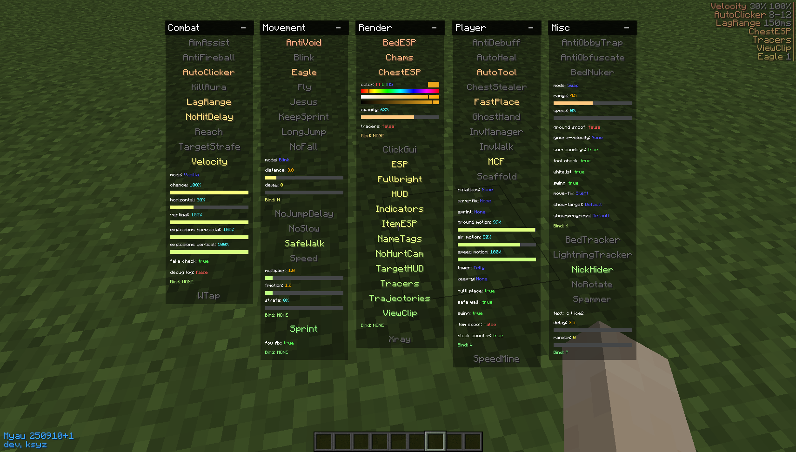

# InjectMyau

Myau for Minecraft 1.8.9, loaded into a game that is already running instead of installed as a mod.

The point of doing it this way is that it works on launchers that will not take a mod file: Badlion
and Lunar ship their own closed clients, and neither has a mods folder you can drop something into.
An injector does not need one. Start the game, press a button, and the client is inside it.

Forge still works too — the same build runs there, and that is the easiest place to develop against.



## 中文说明

把 Myau 1.8.9 客户端以 JVMTI 注入的方式塞进一个**已经在跑**的游戏里，不装成 mod。适用于没有
`mods` 目录的启动器（Badlion、Lunar），也适用于 Fabric/Ornithe 系的 1.8.9 客户端
（`KnotClassLoader` + calamus gen2 命名）。Forge 同样能用，开发时最省事。

### 修复的已知问题

原版在 Fabric/Ornithe 这类运行时上有一批已知的 bug：注入进得去、日志也写得出来，但 HUD、
ClickGUI、BlockIn、FreeLook 各有各的坏法。这次把它们都修了：

1. **注入落错加载器**：`KnotClassLoader` 不是 `URLClassLoader`，原版退到
   `AddToSystemClassLoaderSearch`，`myau.*` 被定义在系统加载器里，看不见游戏类，回调也回不来。
   改为反射拿 `KnotClassLoader.delegate`，调 `KnotClassDelegate.addCodeSource(Path)`。
2. **类文件版本读不了**：Ornithe 的类是新 JDK 编的（class major 69），原版用的 ASM 直接抛
   `Unsupported class file major version 69`，retransform 一个类都过不去。升到 ASM 9.9。
3. **成员 id 串号**：同一个 mcp 名（如 `onUpdate`）在表里对应多个 srg，原版只取第一个，被
   `FoodStats` 抢走 `m_20638750`，于是 `UpdateEvent` / `PlayerUpdateEvent` 从不派发，
   BlockIn 一块砖都不放。现在把这个名字下的**全部** srg 展开成候选 id。
4. **自己类里的 `@Override` 全部失效**：calamus 按**声明类**发 id
   （`GuiScreen.drawScreen(IIF)V` 是 `m_93956703`，`GuiSlot.drawScreen(IIF)V` 是 `m_60498464`，
   同签名不同 id）。原版不给我们自己的类改名，覆盖方法落空，结果窗口能打开、键鼠有反应、
   却一个像素都不画。现在沿父类链找到游戏类的 id 再改名。
5. **FreeLook 的鼠标接管挂不上**：原版钩 `EntityRenderer.updateCameraAndRender` 里的调用点，
   但那次调用编译时 owner 是 `EntityPlayerSP`、成员声明在 `Entity`，永远匹配不到。改成钩
   `Entity.setAngles(FF)` 方法头：激活且对象是玩家时把位移写进 `cameraYaw/cameraPitch` 并取消
   原方法体，身体不再跟着鼠标转。
6. **诊断写进游戏目录**：原来往 `.minecraft\myau-diag.log` 写，现在全部进
   `%TEMP%\myau-native.log`（每行带 `[myau-client]` 前缀），和注入器日志同一个文件。

### 已知限制

`RenderGlobal.setupTerrain` 的视锥剔除钩子在该客户端的 `setupTerrain` 已被其他 mod 改写
（调用表里是 `handler$cko000$polyplus$recullStagedCamera`、`ArgentumWorldRenderer` 等），
暂时挂不上；HUD、ClickGUI、BlockIn、FreeLook 已实机可用。

### 排错先看哪里

`%TEMP%\myau-native.log`。它记录了每个 hook 的落地情况（`patched X (n/m): [...]`）、
没能解析的名字，以及 `no insertion point` 时附带的该方法内**同描述符的所有调用**
（`-- same-desc calls: [...]`），用来判断调用点到底长什么样。

## Known issues fixed in this build

The original build reaches a Fabric/Ornithe client but breaks in specific, reproducible ways.
These are the known bugs and what was done about them.

- **Payload landed in the wrong loader.** `KnotClassLoader` is not a `URLClassLoader`, and the
  fallback `AddToSystemClassLoaderSearch` defined `myau.*` in the system loader — invisible to the
  game classes, with callbacks the rewritten game could not resolve. It now reflects into
  `KnotClassLoader.delegate` and calls `addCodeSource(Path)`.
- **Newer class files refused to load.** Ornithe compiles with a modern JDK (class major 69) and the
  ASM that shipped with legacy Forge threw `Unsupported class file major version 69` before a single
  class was retransformed. The build now ships ASM 9.9.
- **Member ids collided.** One mcp name (`onUpdate`) maps to several srg names; taking only the first
  let another class (`FoodStats`) claim the id, so `UpdateEvent`/`PlayerUpdateEvent` never fired and
  BlockIn did nothing. Every srg under that name is now expanded into candidate ids.
- **Overrides in our own classes never applied.** calamus issues ids per *declaring* class
  (`GuiScreen.drawScreen(IIF)V` is `m_93956703`, `GuiSlot.drawScreen(IIF)V` is `m_60498464`). The
  original build left our own classes unrenamed, so the screen opened, input worked, and nothing
  was drawn. Overrides are now renamed to the parent's id.
- **FreeLook's mouse takeover never attached.** The original hooked the call site inside
  `EntityRenderer.updateCameraAndRender`, but that call is compiled against `EntityPlayerSP` while
  `setAngles` is declared on `Entity`. It is hooked at `Entity.setAngles(FF)` instead: while
  freelook is active the delta drives `cameraYaw`/`cameraPitch` and the body keeps its rotation.
- **Diagnostics polluted the game directory.** `myau-diag.log` used to be written into `.minecraft`;
  everything now goes to `%TEMP%\myau-native.log` with a `[myau-client]` prefix.

Known limitation: the `RenderGlobal.setupTerrain` frustum hook cannot be placed because other mods
rewrite that method on this client (`handler$cko000$polyplus$recullStagedCamera`,
`ArgentumWorldRenderer`, …). HUD, ClickGUI, BlockIn and FreeLook work.


## Layout

```
InjectMyau/
├── OpenMyau-Inject/    the client itself (Java, Gradle, Forge 1.8.9)
└── myau-natives/       the loader and the injected DLL (C++, CMake, Windows)
```

The two build separately and meet once: the loader embeds the client jar as a resource, so the
Gradle build has to run first and the CMake build picks its output up from
`../OpenMyau-Inject/build/libs`.

## Requirements

| | |
|---|---|
| Building the client | JDK 17 |
| The client itself | targets Java 8 — Gradle handles this with a toolchain, no second JDK needed |
| Building the loader | CMake 3.15+, Visual Studio 2022 (or another MSVC toolchain), Windows |
| Running | Windows, 64-bit |

JDK 17 is not a preference. The Gradle build pulls in `architectury-pack200`, which refuses to run
on anything below 16, and 21 and above break other parts of the toolchain. Point `JAVA_HOME` at a
17 and leave it.

## Building

### 1. The client

```bash
cd OpenMyau-Inject
./gradlew build
```

The jar lands in `OpenMyau-Inject/build/libs/`. On Windows use `gradlew.bat`.

### 2. The loader

```bash
cd myau-natives
cp urls.cmake.example urls.cmake
cmake -S . -B build -G "Visual Studio 17 2022" -A x64 -DJAVA_INCLUDE="<your-jdk>/include"
cmake --build build --config Release
```

`urls.cmake` is where the loader gets the addresses it downloads the payload and the changelog
from, one entry per release channel. It is not in the repository — copy the example, put your own
hosting in it, and it stays local. Without it the build falls back to `example.invalid` and the
loader has nowhere to download from. Passing `-DPAYLOAD_URL=` and friends on the command line works
too and overrides the file.

`JAVA_INCLUDE` is only needed if `JAVA_HOME` is not already pointing at a JDK — the build reads it
from there by default. It has to be a JDK and not a JRE, because the injected DLL is a JVMTI agent
and needs `jni.h` and `jvmti.h`.

The configure step fails outright if it cannot find a client jar. That is deliberate: a loader with
no client in it looks like it works and then does nothing.

The result is `myau-natives/build/Release/myau_loader.exe`, with the DLL and the client jar built
into it. It is the only file you need to keep.

## Using it

1. Start Minecraft 1.8.9 — Forge, Badlion or Lunar.
2. Get to the main menu. Do not join a server yet.
3. Run `myau_loader.exe` and press **Load**.

The loader looks for a running `java.exe` or `javaw.exe` that is a Minecraft process, writes the DLL
and the client jar to `%TEMP%`, and attaches. It says **Loaded** when the client is in.

Once it is in, `RSHIFT` opens the menu and `.help` in chat lists the commands.

Injecting twice into the same game does nothing the second time — the classes are already loaded and
will not be read again. To pick up a new build, close Minecraft, start it again, and inject the new
loader.

### Legit Scaffold

Enable `visual-sneak` in **LegitScaffold** to make the first-person camera follow its
automatic crouching and standing. It uses the normal Minecraft 1.8.9 eye heights,
including on clients whose camera otherwise follows the physical sneak key.
The option is off by default and only changes the camera; movement and sneak timing
keep their existing behavior. Third-person and sleeping/riding cameras are unaffected.
In `sneaking-only` mode, holding the sneak key enables the scaffold logic; the camera
uses the module's per-tick crouch/stand decision even if a launcher restores the held
key state later. Camera state is cleared when changing worlds or disabling the module.

### Meowtils compatibility

When Meowtils is installed, KillAura also notifies its attack event listeners so
features such as DamageTags can observe attacks that bypass the vanilla controller.
This does not add another attack packet or change the attack/block sequence.
Meowtils remains optional; missing or incompatible versions do not interrupt attacks.

### Radar

Enable **Radar** in the render category. `range` controls the horizontal distance in blocks
(64 by default); `radar-radius` and `scale` control its on-screen size independently of HUD scale.
`orientation` supports **HEADING** (forward is up) and **NORTH** (north stays up).
Radar draws at the end of each camera frame, independently of the launcher's HUD caching.

The distance rings mark 25%, 50%, 75% and 100% of the selected range without numeric labels.
The compass and crosshair rotate together and use a consistent style. Compass letters sit
close to the visible outer ring; `show-compass` toggles them (enabled by default).
The center arrow, height chevrons (3+ blocks above/below), nearby player count
and nearest-player highlight make contacts easier to read. `show-names` and `show-distance`
enable labels for up to four nearby players, skipping overlapping labels. `show-outside`
adds dim direction arrows for loaded players beyond the selected range, up to 512 blocks;
it is off by default to keep the edge clear. Distances and counts use the horizontal plane
and respect the player/friend/enemy/bot filters. Radar only displays players loaded by the game.

Position indices remain 0 = top left, 1 = top right, 2 = bottom left, 3 = bottom right,
4 = screen center. In the four corner modes, offsets place the radar center directly without
automatic boundary clamping. Center mode stays centered and does not use offsets.
Existing configs keep their saved colors and positions.

### If something goes wrong

The client writes to `%TEMP%\myau-native.log`, and that is the first place to look. It records every
hook it installed and every name it failed to resolve. `System.out` is not a substitute: Badlion
sends it somewhere you cannot read.

## How it works

The loader is a JVMTI agent. It attaches to the running JVM and asks it to hand back the classes it
has already loaded so they can be rewritten — `ClassFileLoadHook` plus `RetransformClasses`. The
rewriting is plain ASM, injecting calls to the client's own callbacks at chosen points in vanilla
methods. There are no Mixins at runtime.

The one genuinely awkward part is that the three launchers do not agree on what anything is called:

| | Classes | Members |
|---|---|---|
| Forge | MCP (`net.minecraft.client.Minecraft`) | SRG (`func_71410_x`) |
| Lunar | MCP | MCP (`getMinecraft`) |
| Badlion | obfuscated (`ave`) | obfuscated (`aw`) |

So the client ships mapping tables and remaps its own references as its classes load, in whichever
direction that particular game needs. A Mixin build of the same source exists alongside the injected
one and is what runs in a development environment, where Forge names everything itself.

## Development

`./gradlew runClient` starts a Forge development client with the Mixin build, which is a much
shorter loop than rebuilding the loader for every change. The injected path and the Mixin path are
separate implementations of the same hooks, so anything touching one usually has to touch the other
— they are `src/main/java/myau/inject/` and `src/main/java/myau/mixin/`.

## Credits

Based on Myau 250910, and on [OpenMyau](https://github.com/60124808866/OpenMyau). The click GUI came
from Raven b3 by blowsy. Various modules are ported from Raven, Rise and Astralis.

## License

GPL-3.0. See [LICENSE](LICENSE).

This program is free software: you can redistribute it and/or modify it under the terms of the GNU
General Public License as published by the Free Software Foundation, either version 3 of the
License, or (at your option) any later version.

It is distributed in the hope that it will be useful, but WITHOUT ANY WARRANTY; without even the
implied warranty of MERCHANTABILITY or FITNESS FOR A PARTICULAR PURPOSE. See the GNU General Public
License for more details.
